# Vowels That Shine, Butterflies That Speak — research report

<!-- GENERATED FILE: docs/REPORT.md is rendered by `python -m research.run_all` from research/report_template.txt;
     every number below is read from results/summary.json at render time. Edit the template, not REPORT.md. -->

## Abstract

A vocal tract modelled as N = 16 equal-delay lossless tubes and a 16-layer Goupillaud thin film share one
mathematics: the same reflection coefficients c_i = (m_i − m_{i+1})/(m_i + m_{i+1}), the same characteristic
polynomial D(z), and the same power transfer ∏(1 − c_i²)/|D|². We verify this numerically. Three independent codes
(Abelès film matrices in optical units, an acoustic ABCD chain in physical units, and the polynomial) agree to
2.8e-12 (absolute) for all 36 Hillenbrand vowel means. Under the canonical
mapping, one 2π period of the tube response spans 400–750 THz, so every vowel has a colour and every film has a
voice. The main finding is that **speech lands where the eye barely sees**. F1 maps to
415.3–442 nm, where the luminous efficiency ȳ is at most
0.0257. All 36 vowels are violet (CIELAB hue 307.5–321.5°),
and vowels within a group differ by a median of only 4.33 /
5.69 / 7.68 ΔE00 (men / women / children,
equal luminance).

Physical realizability is the bottleneck. Ideal vowel films need refractive indices up to
96.8 (median) and 649.6 (max). Compressing them into n ∈ [1, 2.5]
broadens the formants to about 1939.7 Hz, which turns the vowels into near-flat
"whispers" (median 0 envelope peaks ≥ 1 dB below 4 kHz).

Metamers exist both ways:
- **Same colour, different voices.** 804984 atlas pairs have ΔE00 < 2, with a median voice
  distance of 0.317 in ln-Hz, about twice the typical spacing between neighbouring
  vowels. Inverse design gives 8 exact metamers per target colour.
- **Same voice, different colour.** Exact layer-peeling families share one polynomial and so have identical voices.
  At normal incidence their chromaticities are identical (xy spread 0)
  while Y ranges over 7.66–38.18.
  At 60° the family members separate (median equal-luminance ΔE00 8.222).

Tilting a film changes both its colour and its formants: iridescence is a diphthong.

## How to reproduce

```
. .\tools\env.ps1
python -m research.run_all            # ~10-20 s with caches; --fresh rebuilds them (~2-3 min); timings in results/runtime.json
```

The run writes:
- figures to `results/fig_*.png`;
- audio to `results/audio/*.wav` (16 kHz);
- all numbers to `results/summary.json`;
- this report to `docs/REPORT.md` (from `research/report_template.txt`);
- copies of the figures, audio and `summary.json` to `web/results/`.

It caches `results/cache_atlas_pairs.npz` (metamer pair search) and `results/cache_design_stacks.json`
(inverse design, the slow step). The 20 000-stack atlas `results/atlas.npz` comes from `python -m tools.build_all`.

## Method

All conventions are those of `docs/CONTRACT.md`. A short summary:

- **Shared object (§2).** The media vector is m = [m_0 … m_{N+1}]:
  - Tube: glottis termination, then sections from glottis to lips, then radiation.
  - Film: incident medium, then layers, then substrate.
  - Ideal mode uses n_i = m_i / min(m).
  - Reflection coefficients are c_i = (m_i − m_{i+1})/(m_i + m_{i+1}), and D(z) comes from the row recursion.
- **Mapping (§4).** Every layer has the optical thickness n·d = 428.275 nm (Goupillaud), so
  ω_tube = 2πf/F_s equals 2δ_film and f(ν) = F_s·frac(ν/Δν) with Δν = 350 THz.
  - 700 THz maps to 0 Hz and 525 THz maps to 8 kHz. These are the two mirror points, because |D|² is even in ω.
  - 400 THz maps to 2285.7 Hz.
- **Vowels (§3).** Hillenbrand et al. (1995) group means (F0, F1–F3; 12 vowels × men, women, children) are processed
  as follows:
  1. Synthesise each vowel with a Rosenberg source. The bandwidths are 80/100/150 Hz (illustrative).
  2. Take a 16th-order LPC.
  3. Convert the reflection coefficients to an area function.
  4. Prepend a finite glottis, R_GLOTTIS = −0.9 (illustrative).
  5. Build the film in ideal, realizable (n ∈ [1, 2.5]) or materials mode.
- **Film → voice.** `core.film.voice_of_film` samples T over exactly one period of ν, treats it as a power spectrum,
  and applies an inverse FFT and Levinson. The result is exact for Goupillaud stacks and a best all-pole fit
  otherwise.
- **Colour.** CIE 1931 2° observer; illuminants D65, A, F11 and LED-B3; CIELAB; CIEDE2000.
  - "Raw" ΔE00 uses the true Lab, so lightness is included.
  - "Equal-luminance" (eqY) ΔE00 rescales XYZ to Y = 50 first, as in `tools/measure_palette.py`.
  - Swatches use `display_rgb`, an **artistic** exposure normalisation (Y → 50) without chromatic adaptation, so
    swatches under illuminant A look orange.
- **Formant policy.**
  - Primary: poles of the polynomial with bandwidth < 600 Hz (`formants_from_poly`).
  - Secondary, for weak or broad voices (butterflies, angle sweeps, flat metamers): peaks of the LPC envelope
    20·log10(g/|A|), together with their prominence.
  - Section 3 matches each reference formant to the nearest pole of any bandwidth and reports that pole's bandwidth.
- **Vowel-chart unit.** Distance in (ln F1, ln F2), measured against two references:
  - the extent of the 36 Hillenbrand means, 1.619;
  - the median distance from a vowel to its nearest neighbour in the same group, 0.162.
- **Bulk ΔE00.** Atlas pair searches use the vectorised CIEDE2000 of `colour-science`. On 300 pairs
  it differs from `core.colour.delta_e00` by at most 0.
  Quoted example pairs are recomputed with `core`.

---

## 1. The isomorphism, verified

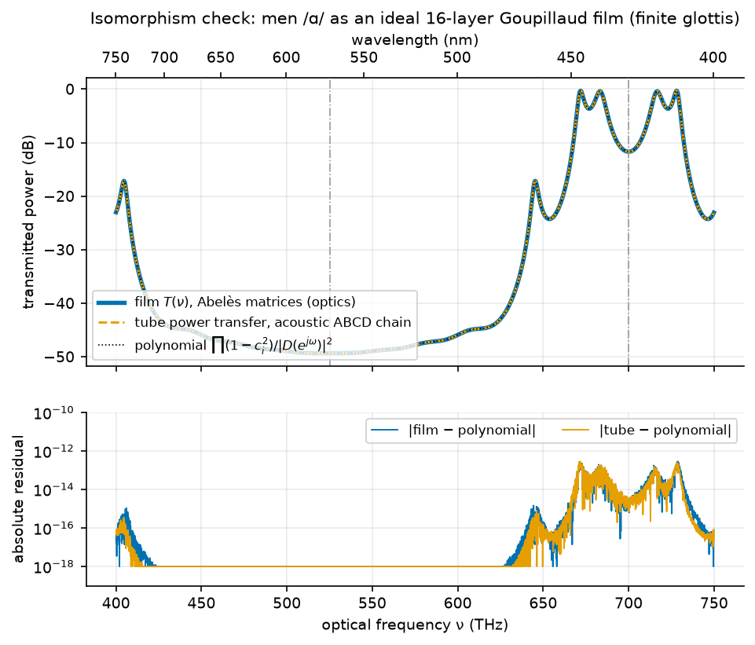

*Figure 1a. Men's /ɑ/ as an ideal 16-layer Goupillaud film with a finite glottis. Top: film transmittance from
Abelès characteristic matrices in optical units (blue), tube power transmission from an acoustic ABCD chain in
physical units (orange dashed), and the polynomial ∏(1−c²)/|D|² (black dotted), against optical frequency; the top
axis shows wavelength. Bottom: absolute residuals, clipped at 10⁻¹⁸ for the log axis. Dash-dotted lines mark the
mirror points.*

| check | max abs. error |
|---|---|
| film − polynomial, men /ɑ/ | 2.86e-13 |
| tube ABCD − polynomial, men /ɑ/ | 2.80e-13 |
| film − polynomial, all 36 vowels (relative error 3.0e-12) | 2.82e-12 |
| tube − polynomial, all 36 vowels | 2.81e-12 |
| film/tube − polynomial, 200 random media (ln m ∈ [−1.5, 1.5]) | 4.58e-11 |
| time-domain Kelly–Lochbaum lattice vs impulse response of ∏(1+c)/D(z) | 8.17e-16 |

The residuals sit at floating-point level. Four independent implementations (optics, acoustics, the polynomial and
a time-domain scattering lattice) are one model.

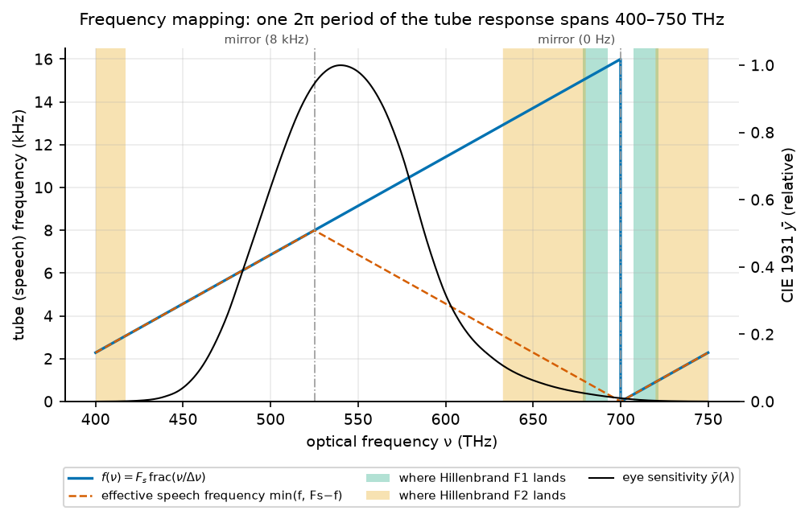

*Figure 1b. The frequency mapping f(ν) = F_s·frac(ν/Δν) (blue sawtooth) and the effective speech frequency
min(f, F_s − f) (dashed). The mirror points are 525 THz (8 kHz) and 700 THz (0 Hz). Shaded bands show where the
Hillenbrand F1 and F2 ranges land. The black curve is the CIE ȳ(λ) eye sensitivity: speech occupies the violet
shoulder where ȳ is tiny.*

## 2. The vowel palette — speech lives where the eye barely sees

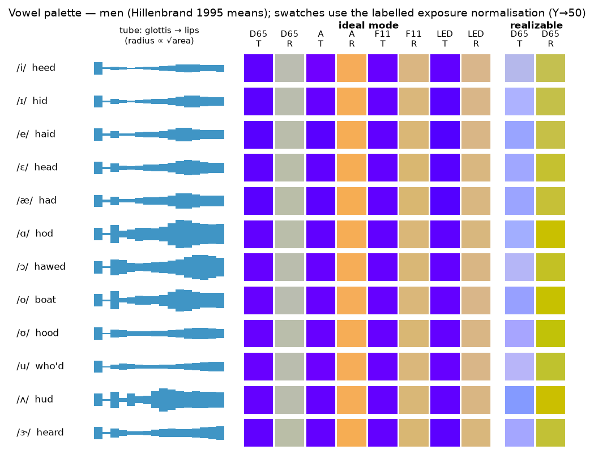
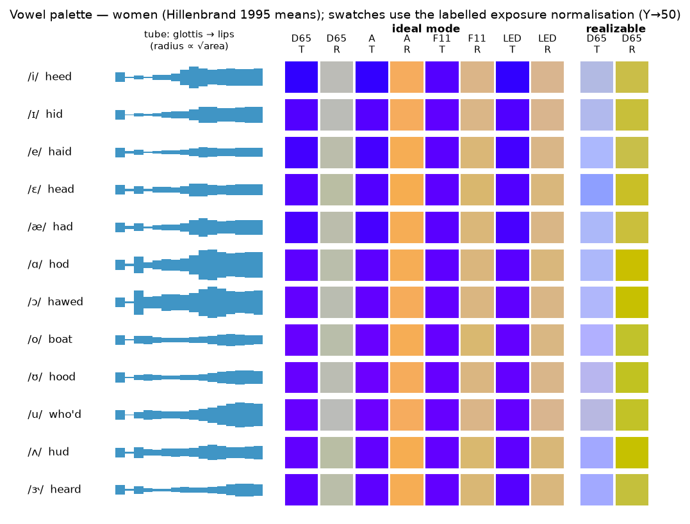
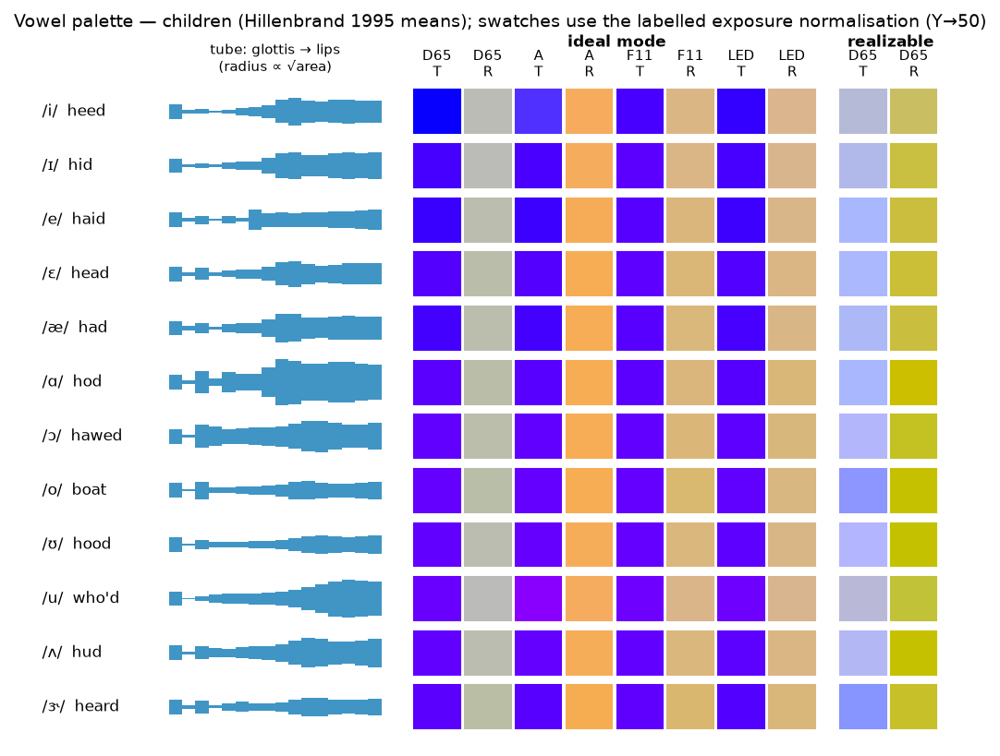

*Figure 2a–c. Twelve vowels per group from the Hillenbrand 1995 means. Each row shows the area function as a tube
silhouette (glottis → lips, radius ∝ √area), then swatches under D65, A, F11 and LED-B3 for transmittance T and
reflectance R in ideal mode, then the realizable-mode D65 swatches. Swatches are exposure-normalised (artistic) and
not chromatically adapted.*

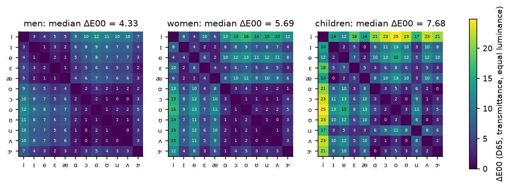

*Figure 2d. Pairwise ΔE00 between the 12 vowels of each group (ideal mode, D65, T, equal luminance).*

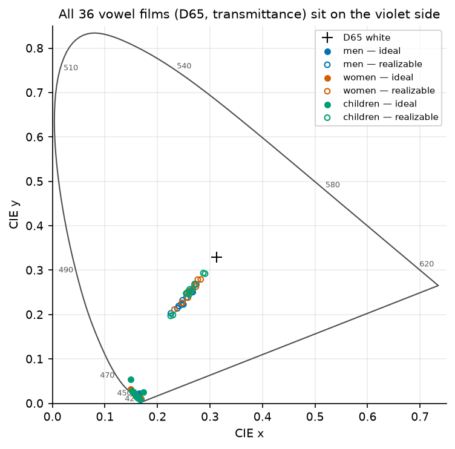

*Figure 2e. CIE 1931 xy chromaticities of all 36 vowel films (filled: ideal; open: realizable) against the spectral
locus and the D65 white.*

**The finding.** The canonical mapping sends 0 Hz to 700 THz (428 nm), so formants sit close to the violet end:

- **Where F1 lands.** The F1 images lie at 415.3–442 nm.
  There the eye's luminous efficiency is ȳ ≤ 0.0257 (median 0.018;
  peak ȳ = 1). F2 images have ȳ median 0.0385 and max 0.1071.
- **Luminance budget.** The part of the visible band that carries 0–4 kHz spans 175 of the 350 THz, but it carries only
  4.9% of the D65 luminance (0–1 kHz: 0.29%).
- **Ideal-mode vowel films are deep violet.**
  - CIELAB hue 307.5–321.5° (median 319.4°).
  - xy chromaticity x = 0.149–0.173, y = 0.009–0.054,
    which is on the purple line next to the 420–450 nm locus.
  - They are almost black: Y_T = 0.046–0.557 (median 0.275).
- **Realizable films are pale lavender**: hue 284.7–295.3°,
  Y_T median 49.74.

The vowels are hard to tell apart by colour:

| group | ideal eqY median ΔE00 (min–max) | pairs < 2 | closest pair | realizable eqY median | ideal raw median |
|---|---|---|---|---|---|
| men | 4.33 (0.09–11.73) | 30% | /ɔ/–/ʌ/ | 3.63 | 2.06 |
| women | 5.69 (0.43–16.42) | 18% | /ʊ/–/ʌ/ | 3.83 | 6.36 |
| children | 7.68 (0.07–24.82) | 8% | /ɑ/–/ɝ/ | 6.51 | 5.35 |

These equal-luminance medians reproduce CONTRACT §7b (ideal 4.3 / 5.7 / 7.7; realizable 3.6 / 3.8 / 6.5).
Children's vowels separate best because their formants are higher and therefore land further from 700 THz. Raw ΔE00
of ideal films is dominated by lightness, because L* is only 0.42–5.03.

Audio of the vowels themselves is in `web/audio/vowel_*.wav` (from `tools/build_all.py`).

## 3. Ideal vs realizable vs materials, and the illustrative glottis

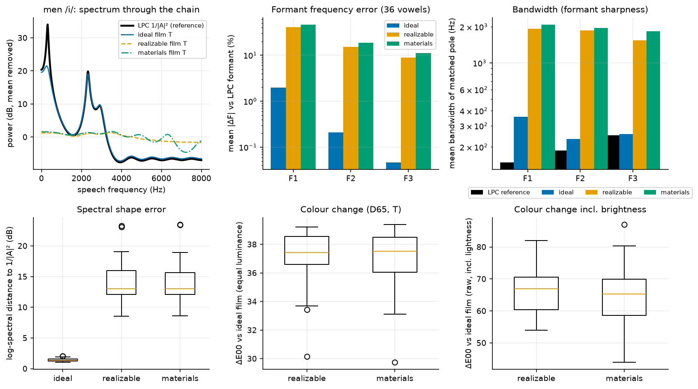

*Figure 3a. The chain LPC 1/|A|² → ideal film (finite glottis) → realizable (n ∈ [1, 2.5]) → materials (snapped to
7 catalogue indices), over all 36 vowels. Top: example spectra for men /i/, mean
relative formant error, and mean bandwidth of the matched pole. Bottom: log-spectral distance (mean-removed dB RMS)
to 1/|A|², and ΔE00 to the ideal film, at equal luminance and raw.*

All formant errors are relative to the LPC polynomial's own poles. As a baseline, the LPC estimate itself differs
from the Hillenbrand targets by 6.01 / 1.56 /
1.2 % (F1 / F2 / F3).

| stage | mean abs. ΔF1 / ΔF2 / ΔF3 (Hz) | mean abs. ΔF (%) | median bandwidth B1 / B2 / B3 (Hz) | LSD to 1/\|A\|² (median, max; dB) | ΔE00 to ideal film, eqY median (raw) |
|---|---|---|---|---|---|
| LPC reference | – | – | 148.9 / 187.5 / 250.4 (mean) | 0 | – |
| ideal film | 10.6 / 3.2 / 0.9 | 1.97 / 0.21 / 0.05 | 291.1 / 178.6 / 183.4 | 1.36, 2.03 | 0 (0) |
| realizable | 222.3 / 244.2 / 252.7 | 40.87 / 15.15 / 8.9 | 1939.7 / 1772.3 / 1596.5 | 13.03, 23.3 | 37.43 (66.98) |
| materials | 245.9 / 304.1 / 321.8 | 46.6 / 18.66 / 11.23 | 2109.9 / 2041.2 / 1913.8 | 13.02, 23.51 | 37.52 (65.26) |

What the stages do:

- **Ideal mode costs only the finite glottis.** F1 shifts by 1.97 % on average, the
  higher formants by less, and the bandwidths grow.
- **Realizability is the real loss.** Ideal vowel films need indices up to 30.5–649.6
  (median 96.8). The compression exponent γ = ln 2.5 / ln(max n) is
  0.141–0.268, which shrinks every reflection coefficient by about 5×.
  - The pole frequencies move by 8.9–40.87 % (F3 to F1).
  - The median bandwidths explode to 1596.5–1939.7 Hz.
  - The LPC envelope of a realizable vowel film has a median of 0
    peaks with ≥ 1 dB prominence below 4 kHz (max 2). The ideal
    films have a median of 3.
  - Realizable vowel films therefore **whisper**.
  - The colour moves from deep violet to pale lavender (eqY ΔE00 ≈ 37.43).
- **Snapping to real materials adds little beyond compression.**
- **Consistency check.** For realizable Goupillaud films, `voice_of_film` returns exactly D(z): the maximum
  coefficient difference is 3.9e-16.

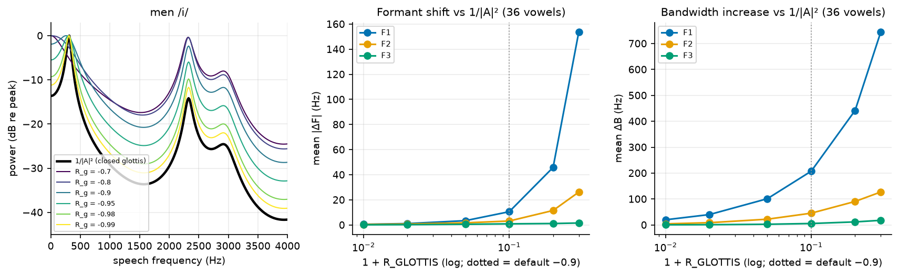

*Figure 3b. The illustrative glottal termination R_GLOTTIS, swept from −0.7 to −0.99 and compared with the
closed-glottis 1/|A|²: men /i/ spectra, mean absolute formant shift, and mean bandwidth increase (36 vowels).*

| R_GLOTTIS | mean abs. ΔF1 / ΔF2 / ΔF3 (Hz) | mean ΔB1 / ΔB2 / ΔB3 (Hz) | median LSD (dB) |
|---|---|---|---|
| −0.7 | 153.7 / 26.2 / 1.6 | 744.4 / 127.2 / 17.9 | 3.06 |
| −0.8 | 45.9 / 11.6 / 1.2 | 441.9 / 90.7 / 11.8 | 2.3 |
| **−0.9 (default)** | 10.6 / 3.2 / 0.9 | 207.5 / 45.4 / 5.6 | 1.36 |
| −0.95 | 3.4 / 1.7 / 0.5 | 101.3 / 22.2 / 2.7 | 0.77 |
| −0.98 | 1.1 / 0.8 / 0.2 | 40 / 8.7 / 1 | 0.34 |
| −0.99 | 0.5 / 0.4 / 0.1 | 19.9 / 4.3 / 0.5 | 0.18 |

The finite glottis mainly broadens F1, and F1 drops slightly; F3 is essentially untouched. The effect vanishes
smoothly as R_GLOTTIS → −1. At −0.99999 the coefficients of D(z) differ from the LPC polynomial a by
9.6e-06. The default −0.9 is a mild, illustrative choice.

## 4. Butterflies that speak

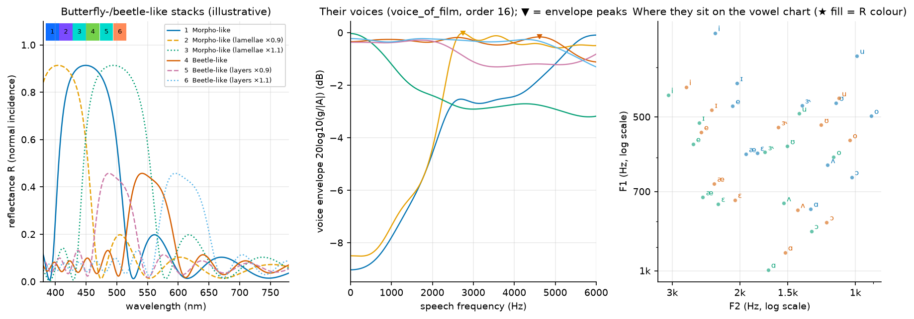

*Figure 4. Parametric Morpho-like stacks (chitin 1.56 / air, 8 pairs) and beetle-like stacks (chitin / n = 1.70,
12 pairs), each with ±10 % thickness variants. **All parameters are approximate / illustrative** (core/stacks.py,
after Vukusic et al. 1999). Left: normal-incidence reflectance, with numbered swatches showing the displayed
R colour. Middle: their voices, from `voice_of_film` with order 16 (▼ marks envelope peaks). Right: position on the
vowel chart (★ filled with the R colour), joined to the nearest Hillenbrand mean.*

| stack | R peak (nm) | R colour | envelope peaks F1, F2 (Hz) [prominence dB] | nearest vowel (ln-dist, fraction of vowel extent) | audio |
|---|---|---|---|---|---|
| Morpho-like | 449.5 | #0f6eff | –, – [–, –] | – (–, –) | [wav](../results/audio/bfly_morpho.wav) |
| Morpho-like (lamellae ×0.9) | 404.5 | #7b4bff | –, – [0.56, –] | – (–, –) | [wav](../results/audio/bfly_morpho_x0p9.wav) |
| Morpho-like (lamellae ×1.1) | 494.5 | #00dacf | –, – [–, –] | – (–, –) | [wav](../results/audio/bfly_morpho_x1p1.wav) |
| Beetle-like | 541 | #74d14a | none ≥ 0.3 dB below 4 kHz (poles B ≥ 2013 Hz) | – (flat voice) | [wav](../results/audio/bfly_beetle.wav) |
| Beetle-like (layers ×0.9) | 487 | #00dacc | none (poles B ≥ 2308 Hz) | – (flat voice) | [wav](../results/audio/bfly_beetle_x0p9.wav) |
| Beetle-like (layers ×1.1) | 595.5 | #ff8a58 | none (poles B ≥ 1964 Hz) | – (flat voice) | [wav](../results/audio/bfly_beetle_x1p1.wav) |

How to read this:

- **Formants come from where the stack is *not* coloured.** A film's voice comes from its *transmittance*, so
  formants (peaks of T) sit where the reflectance is low. The Morpho-like reflection band near 480 nm is an
  anti-formant around 1511 Hz.
- **The voices are weak.** Butterfly-like stacks are not Goupillaud stacks: their layers are 78.6, 145 nm optically,
  not 428.3 nm. Their voices are therefore best all-pole fits to T over the visible period, with fit LSD
  0.36–1.99 dB. The peaks are weak: the default Morpho-like
  stack's F1/F2 prominences are < 1 dB.
- **"Nearest vowel" is only loosely defined for these voices.** For the Morpho-like stack it is
  – of the vowel-space extent away.
  - Only the ×0.9 Morpho variant lands near a real vowel (–, distance
    –, below the neighbouring-vowel spacing of 0.162).
  - The beetle-like stacks, which have low index contrast, have no formants at all: they hiss.

## 5. Metamers both ways

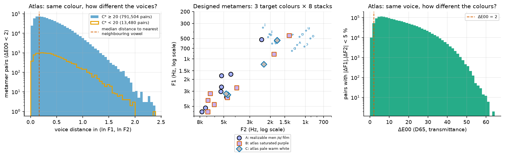

*Figure 5a. Left: for the 804984 atlas pairs with ΔE00 < 2 (D65, T), the distribution of voice
distance in (ln F1, ln F2), split by chroma. The dashed line is the median distance between neighbouring vowels.
Middle: the inverse-designed metamers (3 target colours × 8 stacks, `core.inverse.design_stacks`) on the vowel chart,
filled with their colour. Right: for the 1568647 atlas pairs whose F1 and F2 agree within
5 %, the distribution of ΔE00.*

### 5a. Same colour, different voices

**Atlas.** Of the 20 000 stacks, 10867 have two formants. Screening is exact: a Lab KD-tree
with radius 16 and with radius 20 finds the same 804984 pairs.

| subset | pairs | voice distance in ln-Hz, p10 / median / p90 / max | abs. ΔF1 median (p90) Hz | abs. ΔF2 median (p90) Hz | share more different than neighbouring vowels |
|---|---|---|---|---|---|
| all | 804984 | 0.095 / 0.317 / 0.743 / 2.391 | 882 (2205) | 1026 (2466) | 77.5% |
| C* ≥ 20 (chromatic) | 791504 | 0.095 / 0.316 / 0.741 / 2.391 | 883 (2205) | 1025 (2463) | 77.4% |
| C* < 20 (near-neutral) | 13480 | 0.108 / 0.373 / 0.847 / 2.359 | – | – | 82.0% |
| both voices low-formant (F1 ≤ 1.5 kHz, F2 ≤ 4 kHz) | 100 | 0.048 / 0.109 / 0.307 / 0.712 | 80 (181) | 173 (639) | 34.0% |

**Caveat.** Most atlas voices are not vowel-like. The median "F1", i.e. the first pole with bandwidth < 600 Hz, is
3914 Hz. Only 6 of 10867
stacks fall in the Hillenbrand box (F1 250–1100 Hz, F2 700–3500 Hz), and only 108 have
F1 ≤ 1.5 kHz and F2 ≤ 4 kHz. Among the low-formant metamer pairs the voices still differ: the median distance is
0.109 against a neighbouring-vowel spacing of
0.162, and 34%
of these pairs exceed that spacing.

**Example metamer pair.** Atlas stacks #6973 and
#11945 have ΔE00 = 1.279 (core), with colours
#b9b5f6 and #b7b6f3. Their (F1, F2) are
(836, 2092) Hz, nearest
/ɛ/, and (1443,
3304) Hz, nearest /æ/.
Audio: [metamer_pair_atlas.wav](../results/audio/metamer_pair_atlas.wav).

**Inverse design.** `design_stacks` was run with 40 restarts and 8 diverse solutions per target, for three target
colours drawn from the realizable gamut (§7). The formant-rule column counts how many of the 8 voices were read with
the pole rule, the envelope rule, or had no formants (flat).

| target (Lab) | solutions (max ΔE00 to target) | formant rule: envelope / flat | F1 range (Hz) | F2 range (Hz) | median / max pairwise ln-dist | nearest vowels | audio |
|---|---|---|---|---|---|---|---|
| A: realizable men /ɑ/ film (73.46, 15.13, -41.89) | 8 (8.4e-07) | 6 / 0 | 520–6049 | 2370–7691 | 0.781 / 2.722 | /æ/, /ɑ/, /ɪ/ | [set A](../results/audio/metamer_set_A.wav) |
| B: atlas saturated purple (73.06, 20.63, -28.6) | 8 (5.4e-07) | 2 / 0 | 450–6036 | 1378–6855 | 0.717 / 3.051 | /æ/, /ɑ/, /ɝ/ | [set B](../results/audio/metamer_set_B.wav) |
| C: atlas pale warm white (93.86, 2.57, 5.67) | 8 (1.9e-07) | 7 / 1 | 533–3397 | 1745–4769 | 0.855 / 2.091 | /ɑ/, /ɝ/ | [set C](../results/audio/metamer_set_C.wav) |

The optimiser hits each target colour essentially exactly. Within one colour the voices spread over up to
1.885 × the whole Hillenbrand vowel extent. Many of the
designed voices are weak, which is why the envelope rule is needed for them. Individual voices of set A:
[1](../results/audio/metamer_A_1.wav) [2](../results/audio/metamer_A_2.wav) [3](../results/audio/metamer_A_3.wav)
[4](../results/audio/metamer_A_4.wav) [5](../results/audio/metamer_A_5.wav) [6](../results/audio/metamer_A_6.wav)
[7](../results/audio/metamer_A_7.wav) [8](../results/audio/metamer_A_8.wav).

### 5b. Same voice, different colours

**Atlas (approximate).** 1568647 pairs have |ΔF1| and |ΔF2| < 5 %. This is weaker than
identical voices: F3 and the bandwidths are free. Their ΔE00 runs p10 3.97, median
11.92, p90 27.19, max 64.54.
58.2% of the pairs differ by more than 10 ΔE00, and only
2.0% are also colour metamers. For low-formant pairs
(n = 735) the median is 11.91.

Example: #817 (#6570ff, F1/F2 =
1244/2367 Hz) and
#4989 (#c6baab,
1280/2303 Hz) differ by ΔE00 =
48.87. Audio: [same_voice_pair_atlas.wav](../results/audio/same_voice_pair_atlas.wav).

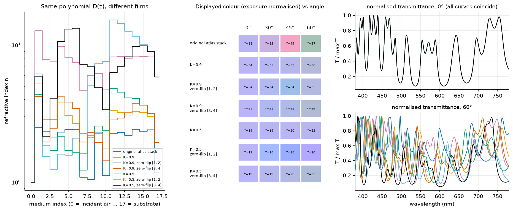

*Figure 5b. An exact same-voice family. Every film has the same polynomial D(z), taken from atlas stack
#6973: formants 836 /
2092 / 3741 Hz, nearest vowel
/ɛ/ (women). The films come from `core.inverse.exact_films_for_polynomial` with the
end-mismatch parameter K and conjugate-pair zero flips. Left: index profiles. Middle: displayed colour and Y at 0°,
30°, 45° and 60°. Right: normalised T(λ) at 0° (all curves coincide) and at 60° (they diverge).*

**Exact families (identical polynomial ⇒ identical voice).** The family has 10 films: the
original stack plus K ∈ {0.9, 0.5, 0.2} × {no flip, two conjugate zero-flips}. Non-conjugate flips do not preserve |G|
and were rejected by checking that D(z) = a.

To keep the incident medium air (n = 1) and avoid total internal reflection at oblique incidence, each exact film is
reversed and rescaled. Reversal is allowed by reciprocity: at normal incidence, T of the reversed film differs from
T of the original by at most 4.6e-15. The indices span
1–58.037, so this is ideal mode.

Checks on the family:
- The T shapes are identical: the ratio T_k/T_0 is constant to 5.2e-11.
- `voice_of_film` returns the same polynomial to 4.6e-12, so the voices are
  identical.

| angle | eqY ΔE00 median / max | raw ΔE00 median / max | xy spread | Y range | F1 range (Hz) | F2 range (Hz) |
|---|---|---|---|---|---|---|
| 0° | 0 / 0 | 15.59 / 35.4 | 0 | 7.66–38.18 | 785–785 | 2162–2162 |
| 30° | 2.72 / 14.157 | 14.8 / 33.03 | 0.04237 | 7.71–35.16 | 717–1992 | 2163–3232 |
| 45° | 6.139 / 30.59 | 16.48 / 44.27 | 0.11511 | 7.84–49.19 | 426–2706 | 1402–3616 |
| 60° | 8.222 / 29.2 | 17.58 / 48.34 | 0.11419 | 8.23–56.62 | 784–2740 | 2150–5312 |

At normal incidence the films show the same chromaticity at different brightness, because T = K/|A|². Away from
normal incidence the layers stop being equal-delay, and both the colours and the voices of the family members come
apart. The F1/F2 at 0° above come from the envelope rule; the pole rule gives 836
/ 2092 Hz. Audio, four members in sequence (they sound identical):
[same_voice_family.wav](../results/audio/same_voice_family.wav).

## 6. Iridescence = diphthong

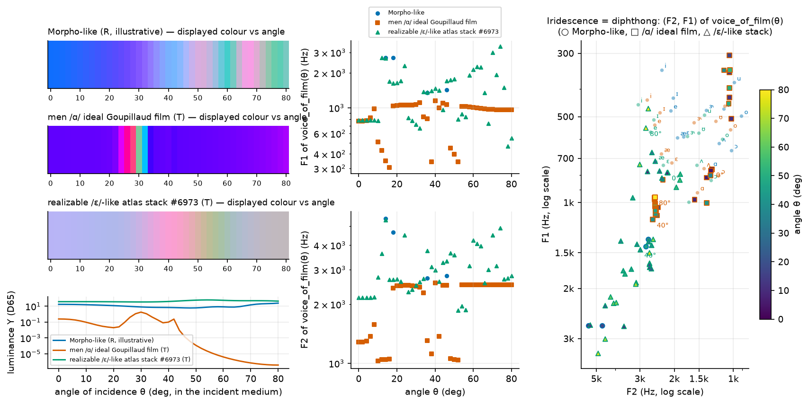

*Figure 6. Angle sweep from 0 to 80° in 2° steps, unpolarised, with the angle measured in the incident medium.
Left: displayed colour against angle, and luminance Y. Middle: F1 and F2 (envelope rule) of
`voice_of_film(θ)`. Right: the same voices on the vowel chart, coloured by angle.*

| film | incident n | Y at 0° → 80° | eqY ΔE00 0°→40° / 0°→80° | (F1, F2) at 0° → 40° → 80° (Hz) | ln displacement 0→20° / 0→40° / 0→80° | nearest vowel at 0/20/40/60/80° | glide audio |
|---|---|---|---|---|---|---|---|
| Morpho-like (R, illustrative) | 1 | 17.7 → 25.08 | 8.94 / 36.59 | (None, None) → no 2 peaks → (None, None) | None / – / None | none none none none none | [wav](../results/audio/glide_morpho.wav) |
| men /ɑ/ ideal Goupillaud film (T) | 1.52 | 0.25 → 0.0e+00 | 2.54 / 22.74 | (765, 1285) → (1148, 2577) → (959, 2516) | 0.727 / 0.806 / 0.709 | /ɑ/ /ɛ/ /ɑ/ /ɛ/ /ɛ/ | [wav](../results/audio/glide_vowel_ah_ideal.wav) |
| realizable /ɛ/-like atlas stack #6973 (T) | 1 | 38.18 → 44.83 | 19.87 / 18.46 | (785, 2162) → (1463, 2986) → (548, 2797) | 0.772 / 0.702 / 0.441 | /ɛ/ /ɑ/ /ɑ/ /ɑ/ /e/ | [wav](../results/audio/glide_atlas_eh_like.wav) |

Tilting a film shortens the phase thickness of each layer by cos θ_j. Because n_j differs from layer to layer,
the layers stop being equal-delay, so tilting a film both moves its colour and moves its formants: a diphthong.

- **Size of the effect.** Within 20° the voices move by None–0.772
  ln-units, which is several neighbouring-vowel spacings (0.162).
- **The trajectories are not smooth.** As the angle changes, envelope peaks appear and disappear
  (F1 jumps > 25 %: 1 / 7 /
  16 times).
- **The /ɑ/ film goes dark.** Its incident medium is n = 1.52, which is not air,
  and its lowest layer index is 1. Beyond the critical angle 41.1° that
  layer becomes evanescent and Y collapses to 0.0e+00 at 80°. The voice there is the
  shape of a vanishingly small T: physically a dark film.
- **Glide audio.** The audio uses `core.synth.sing` over the polynomial sequence 0° → 80° → 0°, at 40 ms per step,
  interpolating in the reflection-coefficient domain.

## 7. The atlas: 20 000 random realizable films, plotted both ways

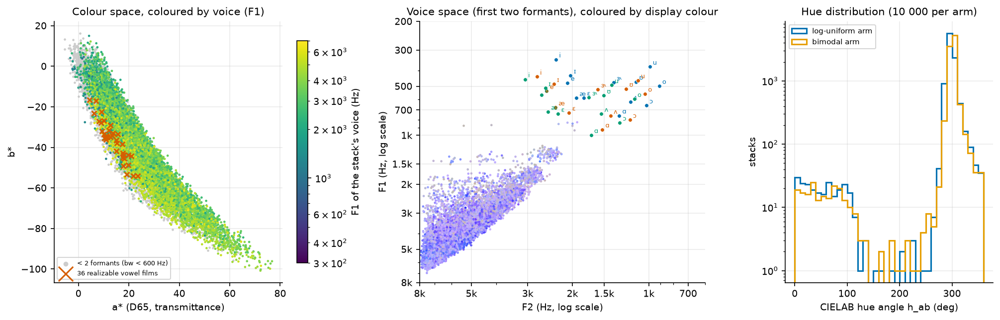

*Figure 7. 20 000 random realizable Goupillaud stacks (`tools/build_all.py`; incident air; D65; transmittance), in
two arms of 10 000: even indices are log-uniform n ∈ [1, 2.5]; odd indices are bimodal, with each layer either low
(1.0–1.25) or high (2.1–2.5). Left: the a*b* plane coloured by the voice's F1. Grey: fewer than 2 formants with
bandwidth < 600 Hz. ×: the 36 realizable vowel films. Middle: the (F2, F1) vowel chart coloured by the stack's
displayed colour, with the Hillenbrand means. Right: hue histograms per arm.*

- **Formants.**
  - The share of stacks with ≥ 2 formants (bandwidth < 600 Hz) is 34.3% for the
    log-uniform arm and 74.4% for the bimodal arm. CONTRACT §7b quotes
    39% (log-uniform) / 74% (bimodal). The bimodal value agrees, but the log-uniform value measured from `atlas.npz` is lower
    (see Limitations).
  - Median F1 is 4518 / 3624 Hz and median F2 is 6093 /
    5268 Hz (log-uniform / bimodal).
  - Only 4 stacks (0.04%
    of those with two formants) lie within one neighbouring-vowel spacing of a Hillenbrand mean.
  - **Random realizable films almost never say a vowel.** Vowel formants need sharp, low poles, which need large
    index contrast.
- **Colours.**
  - 96.0% of stacks have a hue between 270° and 330° (purple/violet). The rest are
    near-neutral. Median chroma is 32.9 / 52.2 (log-uniform / bimodal).
  - Mechanism, which is exact physics: at 700 THz (ω = 0) every Goupillaud layer is an absentee layer, so
    T = T(ends). The median T there is 0.949. At 525 THz (ω = π, 571 nm, near the eye's
    sensitivity peak) every layer is an odd number of quarter-waves, and the median T is 0.522.
    T(700 THz) > T(525 THz) for 85.3% of stacks. Most films therefore pass violet + red and
    block green, which gives purple. The vowels are violet for the same reason.
- **Colour barely predicts voice.** Spearman correlations between Lab and the formants are weak (max |ρ| = 0.201, e.g.
  b* vs F1 -0.201, C* vs F1 0.179). This is the
  statistical face of metamerism.

---

## 8. A second exact mapping: making vowels colourful

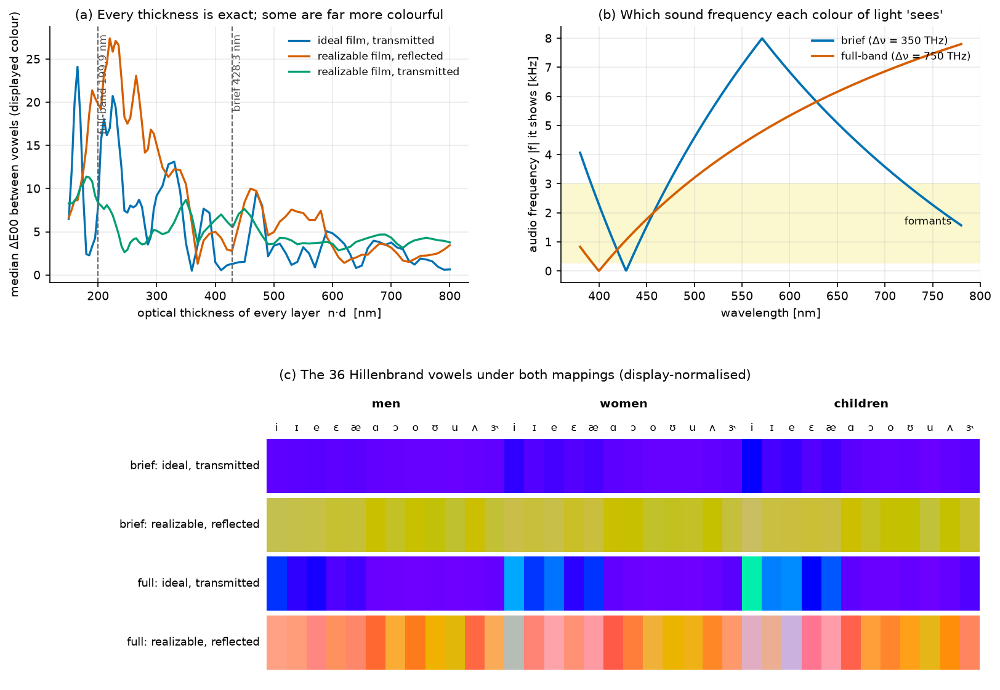

**Why every thickness is allowed.** A layer of optical thickness d_opt has phase δ = 2π·d_opt·ν/c. The film
polynomial is evaluated at ω = 2δ, so the tube frequency is f(ν) = F_s·frac(ν/Δν) with **Δν = c/(2·d_opt)**.
Nothing else in the derivation depends on d_opt. Any common optical thickness therefore gives an exact
tube ⟷ film identity, which `test_isomorphism_any_layer_thickness` checks for four thicknesses (|T − P| < 10⁻¹⁰,
R + T = 1). The brief fixed d_opt = 428.275 nm (Δν = 350 THz), and §2 shows the
consequence: the formants sit in violet.

**The full-band mapping.** With d_opt = 199.862 nm every layer is half-wave at 400 nm, so
Δν = 750 THz and f = 0 falls exactly at 750 THz.
- **No mirror image.** The visible band 400–750 THz shows each audio frequency |f| from 7466.7
  down to 0 Hz exactly once (panel b), instead of 0–8 kHz twice.
- **Formants.** F1 (300–900 Hz) lands at 407.4–423.5 nm and F2 (0.9–2.8 kHz)
  at 423.5–484.5 nm.
- **Fricatives.** Their energy (3–7 kHz) spreads across 492–710.6 nm,
  the part of the spectrum where the eye is most sensitive.

The website uses this mapping by default and keeps the brief's mapping one click away.

**Measured on what is actually displayed.** Colours are compared after the display normalisation and gamut scaling.
Panel (a) sweeps d_opt. The median ΔE00 between the 12 vowels (mean over the three groups) is:

| film, view | brief mapping | full-band | best in sweep |
|---|---|---|---|
| ideal, transmitted | 1.3 | 7.8 | 24.1 at 165 nm |
| realizable, reflected | 2.8 | 19.8 | 27.4 at 220 nm |
| realizable, transmitted | 5.6 | 8.4 | 11.4 at 180 nm |

The curve is jagged, because a small change of d_opt moves a formant image across a steep part of the colour-matching
functions. The full-band value was chosen for its clean physical meaning, not by optimising the sweep. It sits close to the
best region.

**All 1617 Hillenbrand tokens.** Each token goes through LPC, film and displayed colour, and is then
classified to the nearest vowel centroid of its group (12 classes, chance 8 %). The between-centroid figures are median ΔE00.
The same classifier on the formants themselves reaches 82% / 75% / 75%.

| mapping, film, view | accuracy (m / w / c) | ΔE00 between vowels (m / w / c) | ΔE00 token-to-own-centroid |
|---|---|---|---|
| brief, ideal, T | 41% / 38% / 37% | 0.76 / 1.43 / 1.58 | 0.12 / 0.24 / 0.31 |
| brief, realizable, R | 33% / 38% / 41% | 1.86 / 2.08 / 2.18 | 1.01 / 1.01 / 0.96 |
| full-band, ideal, T | 48% / 42% / 42% | 3.41 / 6.77 / 13.66 | 0.31 / 0.58 / 1.03 |
| **full-band, realizable, R** | 32% / 33% / 32% | **15.86 / 16.64 / 16.47** | 5.54 / 6.79 / 8.55 |

**Reading.** Under the brief mapping, vowel colours differ by about 1–2 ΔE00, about the threshold of what a viewer can notice.
Under the full-band mapping:
- **Seen in reflection**, realizable films differ by about 16 ΔE00 between vowels, which is clearly visible. Front vowels
  appear pink or salmon, back vowels orange or amber (median hue 51°).
- **Seen in transmission**, ideal films run from cyan through blue to violet.

**Colour is a coarse code for vowel identity.** A colour has only 3 dimensions, and the order-16 spectrum is squeezed into
them. As a result, a vowel's colour identifies it in only 30–50 % of tokens, against 75–83 % for the formants
themselves. Colours change clearly from vowel to vowel, but tokens of different vowels can share a colour.

**Sensitivity to the two illustrative inputs** (full-band mapping, median / max ΔE00 relative to the defaults over the 36 means):

| change | ideal, T | realizable, R |
|---|---|---|
| bandwidths × 0.5 | 0.16 / 8.24 | 6.46 / 38.63 |
| bandwidths × 2 | 0.23 / 12.62 | 5.53 / 29.18 |
| glottis r = −0.8 | 0.17 / 5.39 | 4.13 / 18.53 |
| glottis r = −0.95 | 0.12 / 6.53 | 4.73 / 9.92 |

The transmitted colour of ideal films hardly depends on these choices. The reflected colour of realizable films shifts by a
few ΔE00 on average, which is smaller than the about 16 ΔE00 that separates vowels. A few vowels move a lot, so the
exact shade of an individual vowel should not be over-read.

R_GLOTTIS = −0.9 has a physical reading. A finite glottis is a section of area A_g ending the tract of area A_1, with
r = (A_g − A_1)/(A_g + A_1). With the code's convention m₀ = A₁(1 + r)/(1 − r), r = −0.9 means A_g/A₁ = 0.053, i.e. A_g ≈ 0.16 cm² for A₁ = 3 cm².
That is the order of magnitude of an open glottis. Typical values of A_g = 0.1–0.2 cm² and A₁ = 2–3 cm² give r between
−0.82 and −0.94, and the table above shows how much the colours move across that range.

## 9. Every sound has a colour: real IPA recordings

43 sounds (14 vowels, 29 others) from Wikimedia Commons IPA recordings
(`data/ipa/ATTRIBUTION.md`) plus modelled items, analysed by `tools/build_sounds.py` (LPC-16 per class rule → film).
Median pairwise ΔE00 between sounds (displayed colours): full-band realizable R 28.33,
brief realizable R 11.08, full-band ideal T 39.02.
Plosives analysed with the fallback rule (context vowel averaged in): p, b, t, d.

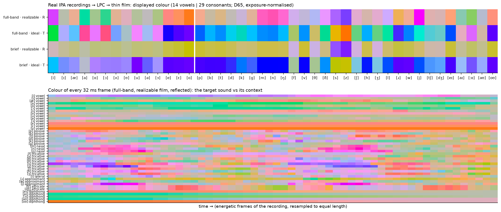

## 10. Every phoneme (experimental)

**Status: experiment.** Every one of the 43 phonemes of `web/data/sounds.json` is turned into a film
(LPC → `vowel_media` → realizable Goupillaud stack, full-band mapping, reflected light), and each class's colours are
collected over the item, every analysed frame of its recording, and the angles 0, 15, 30, 45, 60° (unpolarised).
Every colour is checked to come from a **physically realizable** film: |k| < 1, all indices in [1, 2.5], |c| < 1,
R + T = 1 at normal incidence (17 135 film colours checked for validity, 17 135 pass;
8 995 distinct display colours are plotted in the class gamuts; the per-frame strip
of `sounds.json` is reproduced exactly: True). Ideal films (indices up to
57512.6) are never counted as valid. Distinct colours = complete-linkage clusters of CIEDE2000 ≤ 10
on displayed colours.

| class | items | distinct: item 0° | item × angles | rule frames × angles | **all frames × angles (verdict basis)** | verdict | brief·R (item×angles + frames 0°) |
|---|---|---|---|---|---|---|---|
| vowel | 14 | 9 | 23 | 71 | **78** (1951 colours) | many | 21 |
| diphthong | 5 | 4 | 12 | 51 | **51** (736 colours) | many | 13 |
| plosive | 6 | 4 | 11 | 71 | **68** (1727 colours) | many | 18 |
| affricate | 2 | 1 | 3 | 32 | **39** (332 colours) | many | 11 |
| nasal | 3 | 1 | 4 | 33 | **56** (892 colours) | many | 8 |
| fricative | 9 | 7 | 18 | 72 | **85** (2182 colours) | many | 26 |
| lateral | 1 | 1 | 4 | 29 | **41** (300 colours) | many | 7 |
| approximant | 3 | 3 | 8 | 48 | **67** (875 colours) | many | 13 |

**Rule "one or two colours ⇒ proof".** No class falls to ≤ 2 colours ("few"), so no proof is claimed. Each "many"
verdict comes with a certificate in `web/data/phonemes_experiment.json`: three colours of the class whose pairwise
CIEDE2000 all exceed the threshold. Two such colours can never share a complete-linkage cluster, so the class has at least
three distinct colours; `tests/test_r10_proofs.py` re-checks this. The only collapses occur one level down: the
three nasal items at normal incidence share one magenta, and the two affricates share one colour. The affricates
do so by construction, since both are modelled from ʃ. These are observations only; no proof is offered for them.

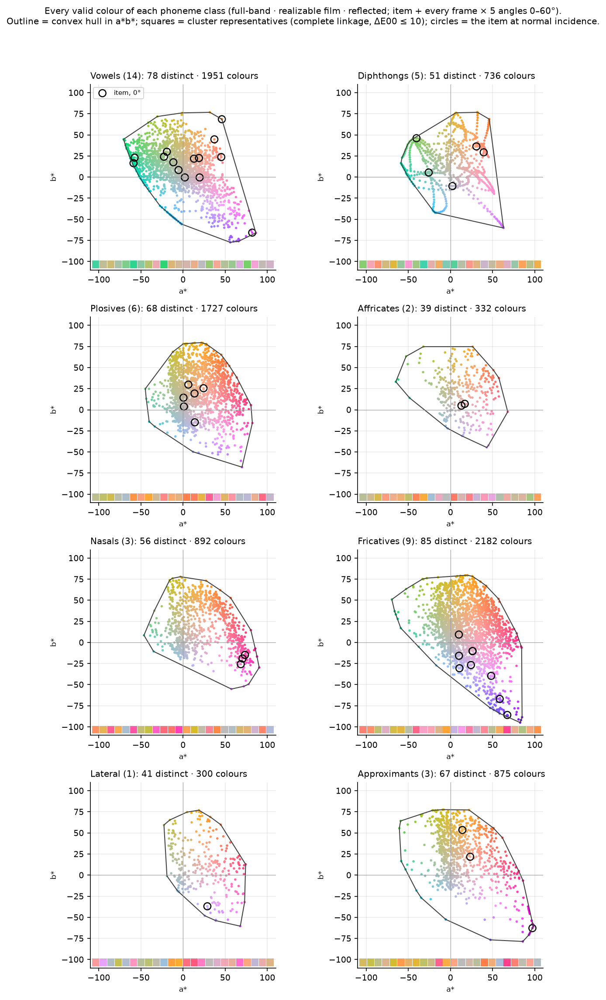

**Films vs butterflies (films, not spectrograms).** Each phoneme's reflectance spectrum (380–780 nm) is correlated
with the butterfly films of the Garden page (Morpho-like, Beetle-like, 4 random Goupillaud "speakers") and with
Morpho/Beetle variants whose lamellae are ×0.9 and ×1.1. The best match is [z] vs Morpho-like ×0.9 (ρ = 0.977,
ΔE00 = 2.61). The most alike films are [z] +0.98, [s] +0.87, [f] +0.75, [θ] +0.69, [ʃ] +0.62. The median ρ over all phonemes is only
0.127, and the nearest film by colour is a median ΔE00 = 15.2 away. The fricatives
look Morpho-like in spectral shape, though not in brightness. A
**chitin/air twin** (8 layers, thicknesses fitted, absolute reflected Lab as target) matches the phoneme colours to
median ΔE00 = 0.00 (max 5.17; 42 of 43 below 2). In other words, every phoneme colour is
reachable with butterfly materials, but with a different stack and therefore a different voice. The all-pole voice
closest to most phonemes is Goupillaud speaker #3 (14 phonemes; the Goupillaud speakers are random equal-thickness films, not insects). /s/ sounds most like
Morpho-like (log-spectral distance 9.44 dB, shape only), and all distances lie between 3.1 and 23.1 dB.

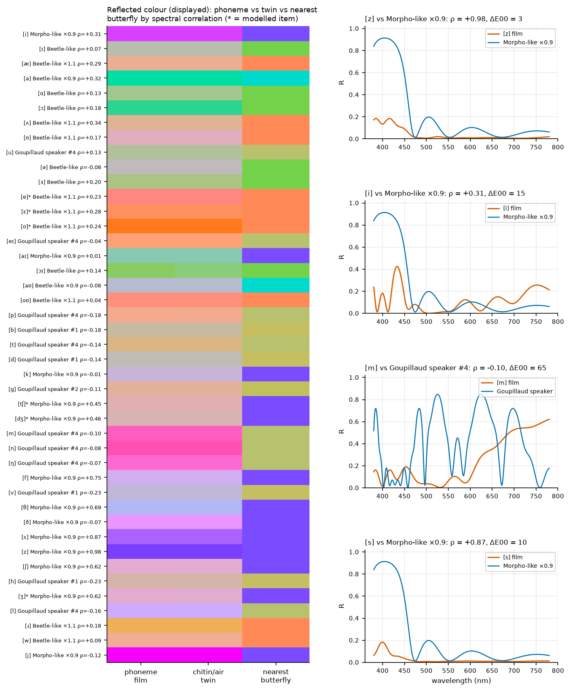
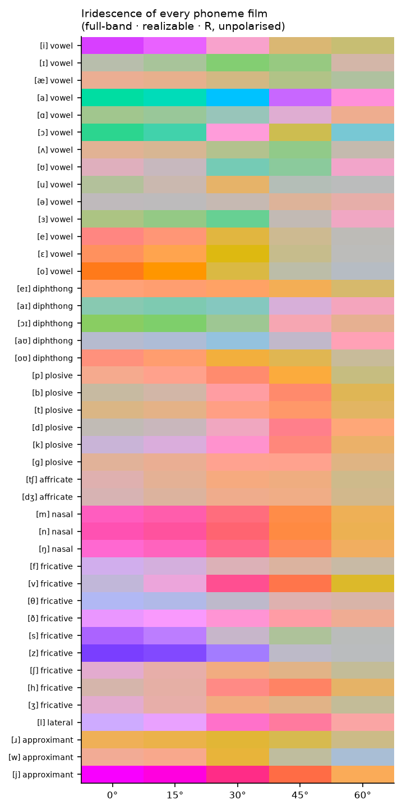

**Real butterfly scales (approximate).** The butterfly films above are idealised 1-D stacks. `core/butterfly.py`
adds measured chitin dispersion, melanin absorption and backing, 5–10 % thickness disorder, lamella tilt and a rough
diffraction spread (thicknesses tuned to published colours are labelled ILLUSTRATIVE). The five species at 0°:
Morpho rhetenor (#44a9ff, 448 nm), Morpho didius (#56a1ff, 432 nm), Papilio blumei (#afc29e, 526 nm), Chrysiridia rhipheus (#8ecb7e, 548 nm), Chrysochroa fulgidissima (#4ed1aa, 540 nm). Against these the most frequent nearest species (highest reflectance correlation) is
Chrysochroa fulgidissima (22 of 43 phonemes). The best match is [z] vs Morpho didius (ρ = 0.705,
ΔE00 = 30.45), and the median ρ is only -0.261. The realistic spectra are broader and dimmer, so
they resemble the phoneme films less than the idealised stacks do.

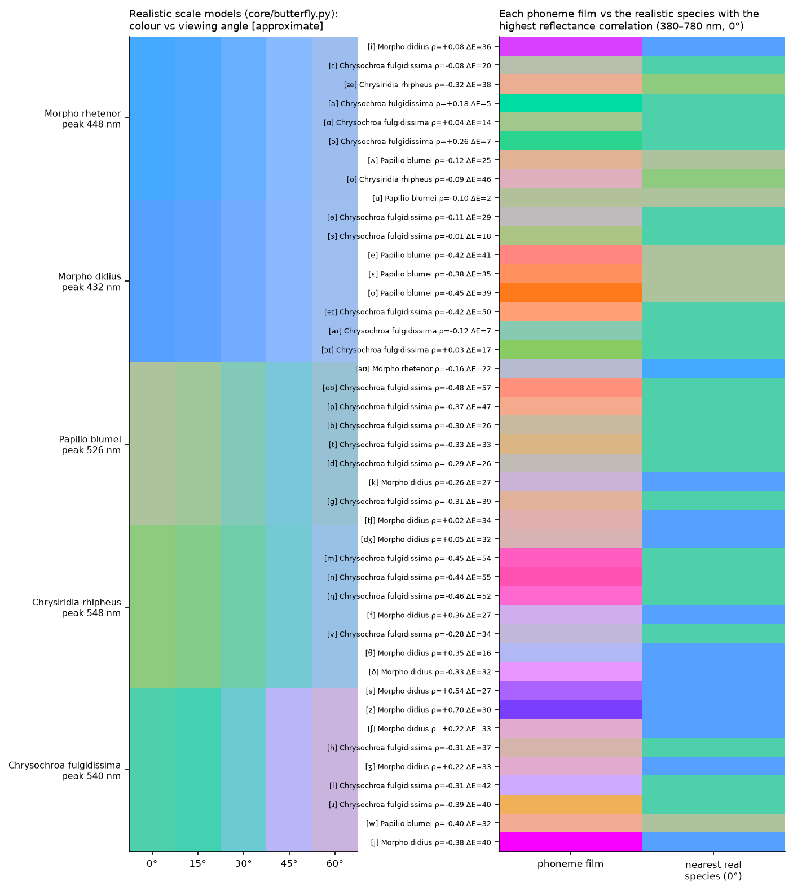

**Fluorescence under blacklight (approximate).** `core/fluorescence.py` puts a papiliochrome-type dye (excitation
420 nm, emission 505 nm, as in *Papilio nireus*; QY and dye strength illustrative) in every layer of each phoneme film.
In daylight the dye adds 11–79 % of the luminance and the colours stay distinct. Under UV-A
(365 nm) all 43 films glow the same green: emission peak 503–510 nm and maximum pairwise
ΔE00 = 1.3 (1 distinct colour). Because this is a "few colours" result, it comes with a proof
(`fluorescence_proof` in `web/data/phonemes_experiment.json`, holds = True). The emission band e(λ) is fixed by the
fluorophore. The film only multiplies it by an escape factor η(λ) ∈ [0.31, 0.51] (realizable n ∈ [1, 2.5]).
If S(λ) = exp(−(λ−λ0)²/2σ²)·w(λ), then at the maximum (λ*−λ0)/σ² = (ln w)′(λ*), so |λ*−λ0| ≤ σ²·max|d ln η/dλ|.
With κ ≤ 0.0165 /nm the bound is ≤ 37 nm; the observed shift is 5 nm. X/Y and Z/Y can change at most
by the factor ρ = max η / min η ≤ 1.64.

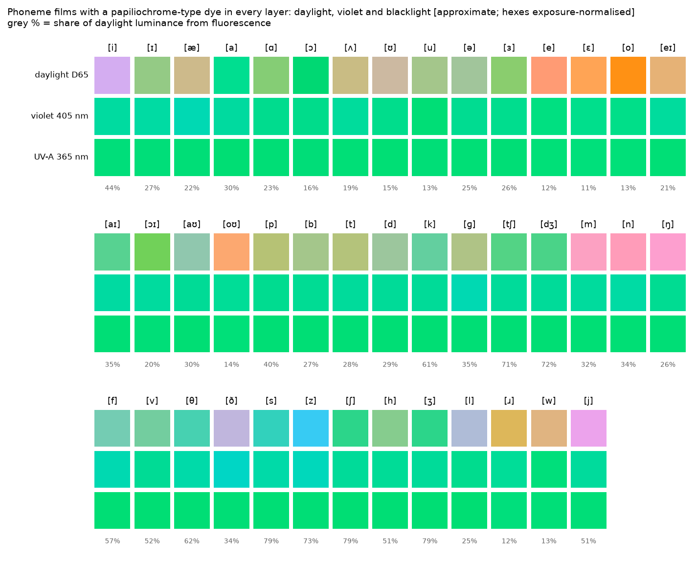

**Honesty notes.** e ɛ o are modelled from Hillenbrand men's means; ʒ = ʃ polynomial; tʃ and dʒ are LAR mixes of
t/d and ʃ (`modelled:true`). p b t d use the fallback rule (all energetic frames, including the context vowel), so their
colour is partly the vowel's. Diphthongs are LAR trajectories between two vowel items. The all-pole film is an envelope
model: nasals have zeros, and fricatives and plosives have a source inside the tract. The colour is well defined, but
the tube reading is approximate. The butterfly parameters are illustrative (`core/stacks.py`). The twin optimiser
works like `core.inverse.design_stacks` (L-BFGS-B on ΔE00) but varies thicknesses with chitin/air held fixed, because
`design_stacks` optimises continuous indices.

## Exact physics vs approximation vs artistic licence

| item | status | note |
|---|---|---|
| r = (a−b)/(a+b) for tube junctions and film interfaces; D(z) row recursion; ∏(1−c²)/\|D\|² | **exact** | lossless, normal incidence; verified to 5e-11 (§1) |
| Goupillaud equal optical thickness ↔ equal tube delay; f(ν) = F_s·frac(ν/Δν) | **exact** | a design choice (mapping), exact once chosen |
| LPC ↔ closed-glottis tube (k_m = −c_m); `voice_of_film` for Goupillaud stacks | **exact** | coefficient error ≤ 5e-12 (§3, §5b) |
| Abelès matrices at oblique incidence, s/p average | **exact** | non-dispersive, lossless, 1-D |
| exact same-voice families (spectral factorisation + layer peeling, reciprocity reversal) | **exact** (T-shape error 5e-11) | ideal-mode indices up to 58.037 |
| CIE 1931 2° colorimetry, CIELAB, CIEDE2000 | **exact** (standard) | no chromatic adaptation |
| Hillenbrand 1995 F0/F1–F3 group means | **data** | bandwidths 80/100/150 Hz are illustrative |
| R_GLOTTIS = −0.9 finite glottis | approximation | effect quantified in §3 |
| realizable compression into [1, 2.5]; material snapping | approximation | large fidelity loss (§3) |
| `voice_of_film` for non-Goupillaud stacks and at oblique incidence | approximation | best order-16 all-pole fit |
| envelope-peak formant rule; ln-Hz vowel distance; "nearest vowel" | analysis convention | weakly defined for flat voices |
| Morpho-like / beetle-like parameters | illustrative | 1-D, no diffraction or disorder, non-dispersive chitin |
| Rosenberg source, jitter, f0 = 140 Hz for film voices | illustrative | |
| swatches (`display_rgb`: Y → 50, clipping) | **artistic** | exposure normalisation for display only |

## Limitations and open issues

- **Lossless and non-dispersive.** There is no wall loss, no radiation impedance, no material dispersion or
  absorption, and no scattering or diffraction. The mapping makes 0–8 kHz occupy the band twice (mirror symmetry).
- **The canonical mapping hides speech in violet.** A π-shifted mapping was tested earlier and separates vowels worse
  (CONTRACT §7b), so the violet palette is a property of this design, not an error.
- **Realizable films cannot reproduce vowel formants.** About 5× compression of the reflection coefficients is
  needed. The isomorphism is exact; physical realizability is the bottleneck.
- **Atlas count mismatch.** CONTRACT §7b states that 39 % of log-uniform stacks have ≥ 2 formants. The atlas in
  `results/atlas.npz` gives 34.3% (the bimodal arm, 74.4%, matches
  74 %). This report uses the measured value. The 39 % probably came from an earlier or quick build.
- **Most atlas and designed voices are not vowel-like** (high or broad formants), and "nearest vowel" is then only
  nominal. Pair statistics use the first two sharp poles.
- **Angle sweeps are noisy.** Envelope peaks switch identity across angles. Trajectories are shown as points rather
  than tracked formants.
- **Performance.** `design_stacks` (L-BFGS-B with numerical gradients over full film spectra) is the slow step of a
  `--fresh` run. `core.colour.delta_e00` is scalar (~0.01–0.05 ms per call), so the atlas pair
  screening uses the vectorised CIEDE2000 of `colour-science`, after checking it against core.

## Audio index (16 kHz WAV, `results/audio/`, mirrored in `web/results/audio/`)

- Butterflies: bfly_morpho.wav, bfly_morpho_x0p9.wav, bfly_morpho_x1p1.wav, bfly_beetle.wav,
  bfly_beetle_x0p9.wav, bfly_beetle_x1p1.wav.
- Same colour, different voices: metamer_pair_atlas.wav, metamer_set_A/B/C.wav, metamer_A_1…8.wav.
- Same voice, different colours: same_voice_pair_atlas.wav, same_voice_family.wav.
- Iridescence glides: glide_morpho.wav, glide_vowel_ah_ideal.wav, glide_atlas_eh_like.wav.

## References

- Hillenbrand, J., Getty, L. A., Clark, M. J., & Wheeler, K. (1995). Acoustic characteristics of American English
  vowels. *J. Acoust. Soc. Am.* 97(5), 3099–3111.
- Kelly, J. L., & Lochbaum, C. C. (1962). Speech synthesis. *Proc. 4th Int. Congr. Acoustics*, Copenhagen, G42.
- Markel, J. D., & Gray, A. H. (1976). *Linear Prediction of Speech*. Springer.
- Wakita, H. (1973). Direct estimation of the vocal tract shape by inverse filtering of acoustic speech waveforms.
  *IEEE Trans. Audio Electroacoust.* 21(5), 417–427.
- Goupillaud, P. L. (1961). An approach to inverse filtering of near-surface layer effects from seismic records.
  *Geophysics* 26(6), 754–760.
- Macleod, H. A. *Thin-Film Optical Filters* (4th ed., 2010). CRC Press.
- Vukusic, P., Sambles, J. R., Lawrence, C. R., & Wootton, R. J. (1999). Quantified interference and diffraction in
  single Morpho butterfly scales. *Proc. R. Soc. B* 266, 1403–1411.
- Rosenberg, A. E. (1971). Effect of glottal pulse shape on the quality of natural vowels. *J. Acoust. Soc. Am.*
  49(2B), 583–590.
- CIE 015:2018. *Colorimetry* (4th ed.). Commission Internationale de l'Éclairage.
- Sharma, G., Wu, W., & Dalal, E. N. (2005). The CIEDE2000 color-difference formula: implementation notes,
  supplementary test data, and mathematical observations. *Color Res. Appl.* 30(1), 21–30.
